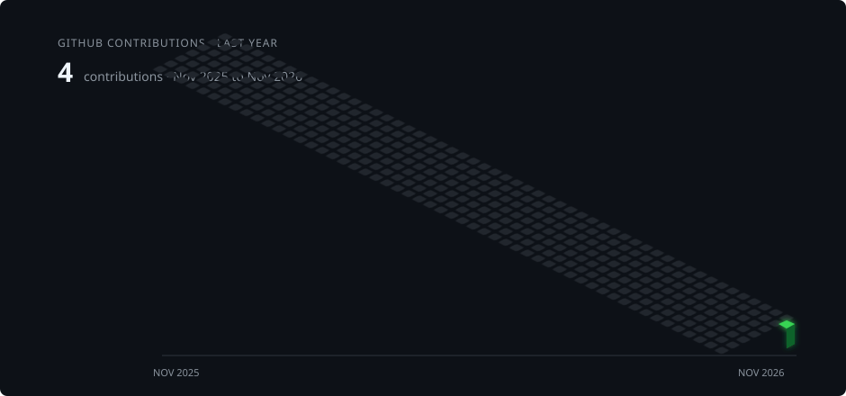

<!-- 3D ANIMATED GITHUB PROFILE · SuJeet / sujeetchoudhary07 -->

  

   

  

  

    
    
    
  

---

## 👨‍💻 About me

I'm **SuJeet Choudhary**, a self-taught **full-stack web/app developer and freelance software engineer** from India. I love turning ambitious ideas into thoughtful, elegant digital products, with a focus on **developer experience, architecture, maintainability, and code quality**.

- 🚀 I enjoy building modern, responsive web and mobile applications.
- 🧠 I'm interested in clean architecture, reusable components, and scalable systems.
- 🤝 I value open source, collaboration, and sharing what I learn.
- 💬 Topics I enjoy: **React, Node.js, JavaScript, backend engineering, and application design**.

## 🧊 My 3D contribution universe

  <!-- Generated on first workflow run; see SETUP.md. -->
  

## 🧰 Technologies & tools

**Frontend and UI**

**Backend and data**

**DevOps, workflow, and design**

## 📊 GitHub at a glance

  
  

  

## 🐍 Contributions in motion

  <!-- Generated by GitHub Actions after first run. -->
  <picture>
    <source media="(prefers-color-scheme: dark)" srcset="./assets/github-snake-dark.svg" />
    <source media="(prefers-color-scheme: light)" srcset="./assets/github-snake.svg" />
    
  </picture>

## 🌐 Connect with me

  
  
  
  
  

  
  
  
  

<b>More community & coding profiles</b>

[CodeSandbox](https://codesandbox.com/sujeetmehra01) · [Facebook](https://fb.com/sujeetmehra01) · [Codeforces](https://codeforces.com/profile/sujeetmehra01) · [HackerEarth](https://www.hackerearth.com/sujeetmehra01) · [GeeksforGeeks](https://auth.geeksforgeeks.org/user/sujeetmehra01) · [Topcoder](https://www.topcoder.com/members/sujeetmehra01)

## ☕ Support

If you like my projects or find something helpful, you can [buy me a coffee](https://www.buymeacoffee.com/hashcode). Thanks for stopping by!

  

<!-- Profile artwork: custom SVGs in assets/. 3D contribution and snake graphics are generated by GitHub Actions. -->
